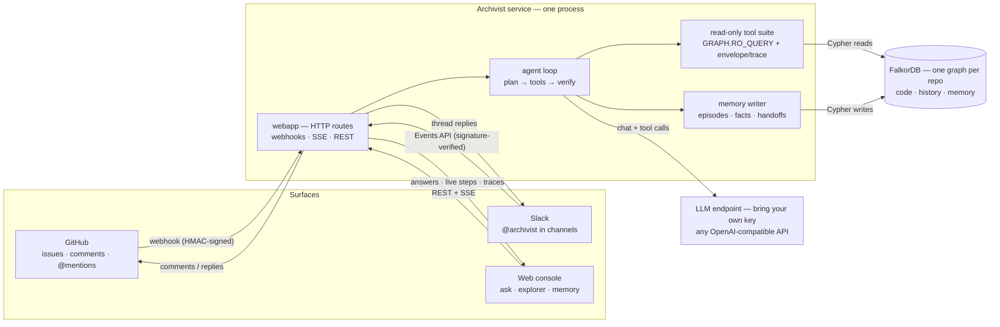
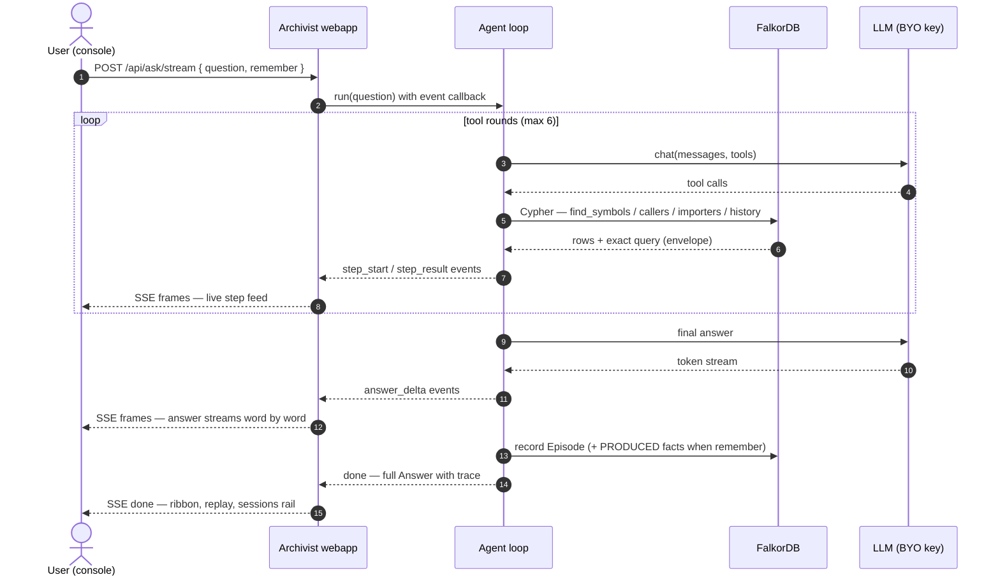
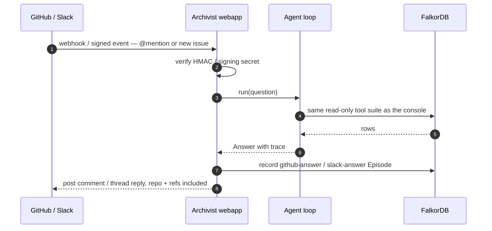

# Archivist

**Graph Hacks 2026 submission (WeMakeDevs × FalkorDB) — work in progress.**

**Live demo:** https://figure-them-trucks-concentrate.trycloudflare.com/console

An engineering-intelligence agent with FalkorDB as its context layer: it turns
a codebase + its git history into a living graph, answers multi-hop questions
with traceable reasoning paths, takes actions, remembers across sessions, and
coordinates multiple agents over shared graph state.

Status: **Console v2 live** (ingest pipeline repeatable & idempotent;
read-only graph tool suite with envelope+trace contract; tool-calling agent
loop with auditable traces; bi-temporal memory; planner → investigator →
verifier crew with handoffs as graph state; Console v2 — landing page, graph
explorer with path finder, ask room with trace replay — see `docs/demo/`).

## Architecture & flow

Three surfaces, one agent, one graph — the agent never touches a side store:
code, history, and memory all live in FalkorDB.



**A console ask, end to end (UML sequence)** — the same flow the SSE stream
mirrors to the screen:



**An inbound mention (GitHub / Slack)**:



## Demo

[`docs/demo/archivist-demo.mp4`](docs/demo/archivist-demo.mp4) (2:36) — a
full pass over the product: the landing, the live graph, explorer + path
finder, the ask room with trace replay, cross-session memory recall, and the
architecture page. Recorded against the live `repo:flask` graph; the ask
scenes run the deterministic scripted-model mode (`serve.py --llm-script`,
see `docs/demo/m4r/ask-script.json`) — the agent loop, tools, Cypher and
every number on screen are live; only the model's next-move choices are
canned, and the console's status chip reads `llm scripted (demo)` throughout.
Captions: [`archivist-demo.srt`](docs/demo/archivist-demo.srt). Re-record with
`scripts/record_demo.py` (one take + event timeline) and
`scripts/assemble_demo.py` (caption burn + H.264 export).

## Quickstart (dev)

Requires Python ≥ 3.11 and a FalkorDB instance on `127.0.0.1:6379`
(pin `falkordb/falkordb:v4.22.1` in production — what this project is tested on):

```bash
docker run -p 6379:6379 --name falkordb -d falkordb/falkordb:v4.22.1
```

```bash
python3.12 -m venv .venv && source .venv/bin/activate
pip install -r requirements.txt

git clone https://github.com/pallets/flask data/flask   # or any repo
python scripts/ingest.py                # -> graph "repo:flask"
pytest -q                               # unit + integration tests
```

Options: `python scripts/ingest.py --help` (`--repo`, `--graph`, `--rebuild`,
`--no-prune`, `--json`). v0 trade-offs and known limitations are documented in
`docs/graph-model.md`.

### Docker

```bash
docker compose up -d --build     # FalkorDB + console -> http://127.0.0.1:8787/console/
docker compose run --rm app python scripts/ingest.py --repo /data/flask --graph repo:flask
```

Console v2 is built inside the image; `data/` is mounted read-write at
`/data` — it holds the demo checkout and, from M6 on, the account store
(`data/accounts`, `data/users/<uid>`). Mount any other checkout with
`-v /abs/path:/repo:ro` and `--repo /repo`. `ARCHIVIST_GRAPH` /
`ARCHIVIST_DEMO_GRAPH` / `ARCHIVIST_PORT` / `FALKORDB_PORT` /
`ARCHIVIST_SIGNUP` / `ARCHIVIST_DEMO_QUOTA` steer the stack, and `ARCHIVIST_LLM_*` in
`.env` enables the ask room (without a key it stays an honest 503).
Details: `docs/DEPLOY.md` §4.

## Graph data model

One graph per repo (e.g. `repo:flask`) — code, history, and agent memory all
live as nodes and edges in FalkorDB, and every answer the product gives is a
Cypher query over it.

**Nodes:** `Repo` · `Commit` (sha, ts, message, `seq` = git-log position, for
stable same-second ordering) · `Author` · `File` (path, lang, loc) ·
`Symbol` (file + qualname, kind) · `Module` · `Episode` (agent session /
ingest run / crew phase) · `Fact` (bi-temporal windows).

**Edges:** `HEAD` · `PARENT` · `AUTHORED` · `MODIFIED {added, removed}` ·
`DEFINES` · `IMPORTS {line}` · `CALLS {count, lines, weak}` ·
`PRODUCED` (episode → fact) · `ABOUT` (fact → anchors) ·
`SUPERSEDES` (fact lineage) · `HANDOFF {note}` (crew phases).

Design rules the tools depend on:

- **Idempotent writes** — every write is a `MERGE` on a stable identity
  (path, sha, email, file+qualname, content-addressed fact id): re-ingest
  and repeated `remember` calls converge instead of duplicating.
- **Guesses are flagged, never hidden** — best-effort `CALLS` resolution
  marks low-confidence edges `weak`; default reads filter those out *and
  report how many were filtered*.
- **Memory is append-only** — a contradicted fact closes its validity window
  and links its replacement via `SUPERSEDES`; invalidate, don't delete.

Full schema, resolver rings, and honest limits:
[`docs/graph-model.md`](docs/graph-model.md).

## Queries & the graph algorithms behind the product

FalkorDB is the load-bearing context layer: each capability below *is* a
read-only Cypher query — the agent loop and the console run the same tool
suite (`GRAPH.RO_QUERY`, enforced in `src/archivist/tools.py`), and every
result carries the exact Cypher it ran. The load-bearing set:

- **Impact — call walks (variable-length traversal).** Bounded `[:CALLS*1..N]`
  expansion from symbol anchors, weak edges excluded by default; reverse =
  callers ("what breaks if this changes"), forward = callees.
  (`callers` / `callees` — `src/archivist/tools.py`)
- **Hop tracing — directed `shortestPath`.**
  `shortestPath((a)-[:CALLS*1..N]->(b))` — directed only, so the reverse leg
  is attempted explicitly before answering "no path", and a path that exists
  only through weak guesses is labelled, not dropped.
  (`GET /api/graph/path` — `src/archivist/webapp.py`)
- **Structure — hubs (degree aggregation).** Most-called symbols:
  `MATCH (c:Symbol)-[e:CALLS]->(s:Symbol) WHERE e.weak = false`, grouped with
  `count(DISTINCT c)`, ordered and limited; the module variant aggregates
  `IMPORTS`. (`GET /api/graph/overview` — `webapp.py`)
- **History — joins over time.** File history: `(Commit)-[:MODIFIED]->(File)`
  ordered `ts DESC, seq ASC` (churn counts from `git --numstat`); ownership
  groups `(Author)-[:AUTHORED]->(Commit)` per author; archaeology is a
  case-insensitive commit-message search. (`file_history` / `owners` /
  `search_commits` — `src/archivist/tools.py`)
- **Memory — bi-temporal interval filtering.** `recall` reads `Fact` windows
  three ways: true-now (`invalid_at IS NULL`), full history, or as-of T
  (`valid_at <= T AND (invalid_at IS NULL OR invalid_at > T)`); `PRODUCED`,
  `SUPERSEDES`, and `HANDOFF` keep provenance and coordination one hop away.
  (`recall` — `src/archivist/tools.py`; writer in `src/archivist/memory.py`)
- **Replay — batch resolution + induced subgraph.** Ask steps send their
  evidence refs; the server resolves them (`UNWIND $pairs AS pr MATCH …`) and
  returns only the edges among the resolved nodes — exactly what the step
  touched; unresolved refs and caps are reported.
  (`POST /api/graph/induced` — `webapp.py`)

Lookup indexes are ensured after each ingest (`INDEXES` in
`src/archivist/graph.py`). Honest perf note: resolver-heavy anchors still
plan as label scans on FalkorDB today — index-shape tuning is logged work,
not hidden.

## Ask questions (agent loop, BYO LLM key)

The agent answers questions by calling read-only graph tools and every answer
carries its full trace (tools called, Cypher run, timings). Any
OpenAI-compatible endpoint works — configure via environment or `.env`:

```bash
ARCHIVIST_LLM_BASE_URL=https://api.openai.com/v1   # or opencode zen, OpenRouter, vLLM, ...
ARCHIVIST_LLM_API_KEY=sk-...
ARCHIVIST_LLM_MODEL=gpt-4o-mini

python scripts/ask.py "who calls url_for?"          # rendered answer + trace
python scripts/ask.py "why is blueprints.py careful?" --json   # machine-readable
```

`OPENAI_BASE_URL` / `OPENAI_API_KEY` / `OPENAI_MODEL` are accepted as
fallbacks; keys never enter the repo. Transient endpoint failures (429/5xx,
timeouts) are retried with backoff; anything that still fails is recorded on
the answer's trace instead of crashing the run. Transcripts:
`docs/demo/m2b-agent-loop.txt` (scripted model, real queries) and
`docs/demo/live-model-smoke.txt` (live model, live graph).

A streaming variant — `POST /api/ask/stream` (Server-Sent Events:
`step_start` / `step_result` / `answer_delta` frames, terminal `done` or
`error`, heartbeats while a step runs) — lets a client render steps and
answers as they happen; `docs/demo/m7b-stream.txt` is a live run end to end.

## Actions (inc1 + inc3)

The agent's reasoning ends in **recorded next steps** — not just answers. When the
evidence warrants a concrete follow-up (review a target, change a file, add/run a
test), the agent calls `act` and the action is persisted to the graph as a `Fact`
with `kind="action"`, inheriting provenance (`PRODUCED` from the episode,
`ABOUT` anchors) and supersession for free.

Proposed actions appear in two places:

- **Memory view → Actions section** — each proposed action has **Mark done** and
  **Superseded** controls. Completing an action closes its validity window;
  superseding it records a replacement linked via `SUPERSEDES`, so the
  bi-temporal story stays visible.
- **Ask trace ribbon** — when an ask emits an `act`, the ribbon shows a
  proposed-action chip linking to the Memory Actions section.

The closed set is deliberate: `review`, `change`, `test`. Anything else is
rejected before it touches the graph — a guessed next step is worse than none.

## Memory (M3)

Every `ask.py` run is persisted to the graph as an `agent-session` episode,
and the agent can `remember` findings (anchored to symbols/files/commits)
and `recall` them later — facts carry bi-temporal validity windows, and a
superseded fact is closed, never deleted. `--no-memory` skips recording.
Mechanics transcript: `docs/demo/m3a-memory.txt` (scripted calls, live
graph, a second session recalling the first).

## Multi-agent crew (M3b)

One question, three roles over the same graph: the **planner** drafts an
executable investigation plan, the **investigator** runs it with the full
tool suite, and the **verifier** re-runs the decisive checks and owns the
final answer. Role tool scopes are enforced, not suggested (the verifier
cannot write memory); each phase is recorded as an `agent-session` episode
and the handoffs are `(:Episode)-[:HANDOFF]->(:Episode)` edges — the crew's
coordination history is queryable like everything else.

```bash
python scripts/crew.py "what breaks if url_for changes, and who should review it?"
```

Mechanics transcript: `docs/demo/m3b-handoffs.txt` (scripted model, live
graph: plan → investigation → independent re-checks, handoff chain read
back out of the graph).

## Web console (M4 → M4R)

Console v2 is the product's face — a landing page, graph explorer (search,
module → file → symbol drill-down, caller/callee neighbourhoods with the
weak-guess filter, directed path finder), an ask room where every answer's
trace is replayed on the canvas as an induced subgraph, a bi-temporal memory
ledger, the three-agent crew view, a commit time machine, a blast-radius
cone (reverse calls, by hop), a who-knows-what ownership ledger (people,
owner mixes, single-owner watch list, per-file reviewers), a ⌘K palette,
and an About page. Built with
Vite + React + TypeScript, served as static assets by the same stdlib
server; console v1 stays archived at `/classic/`.

```bash
python scripts/serve.py            # -> http://127.0.0.1:8787  (graph repo:flask)
```

```bash
cd console && npm ci && npm run build   # build Console v2 assets (Node ≥20.19)
```

The explorer works without an LLM key. The ask room runs on the server's
`ARCHIVIST_LLM_*` when present, and visitors can bring their own key — base
URL / model / key are kept in the visitor's browser and sent per request
(the server never stores or logs them); asks that spend the server's demo
key are capped per client (`ARCHIVIST_DEMO_QUOTA`, default 40/hour, `429`
past the cap with a hint to bring a key). Screenshots and mechanics
transcripts: `docs/demo/` (`docs/demo/m4r/` for v2; v1's JSON-layer
transcript is `docs/demo/m4a-console.txt`).

## AI-assist disclosure

Built with AI coding assistants; design direction, review, and final
verification by the submitter. (Disclosed per the event rules.)

> Built during the Graph Hacks event window (Oct 15–18, 2026).

## For judges

How to test the live agent in 3 minutes: see [JUDGES.md](JUDGES.md).
Full submission summary: [SUBMISSION.md](SUBMISSION.md).
